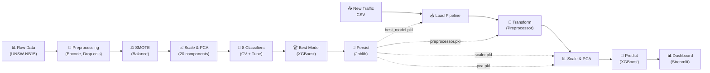

# Network Intrusion Detection using UNSW-NB15

[](https://github.com/Pratyay-Bera/network_intrusion_detection)

This project implements an end-to-end **Machine Learning pipeline for Network Intrusion Detection** using the **UNSW-NB15 dataset**. The system processes network traffic data, addresses class imbalance, trains and compares multiple classifiers, selects the best-performing model, and exposes predictions through a Streamlit dashboard.

The deployed system classifies network traffic into:

* 🟢 **Normal Traffic**
* 🔴 **Attack Traffic**

## Data Flow Diagram



**Training Phase** (left): Data loading → Preprocessing → Balancing → Scaling & Dimensionality Reduction → Model Training & Tuning → Best Model Persistence  
**Inference Phase** (right): New Data → Transform-Only Pipeline → Prediction → Visual Insights

---

## Features

1. Dataset loading and preprocessing
2. Categorical feature encoding using **One-Hot Encoding**
3. Data balancing using **SMOTE**
4. Class distribution visualization
5. Feature scaling using **StandardScaler**
6. Feature importance analysis using **Random Forest**
7. Correlation heatmap
8. Dimensionality reduction using **PCA**
9. Training of **8 classification models**
10. **10-fold cross-validation**
11. Hyperparameter tuning using **GridSearchCV**
12. Model evaluation using:

    * Accuracy
    * Precision
    * Recall
    * F1-score
    * Macro F1-score
    * Attack Recall
    * ROC-AUC
    * Confusion Matrix
13. Model comparison and visualization
14. Best model selection based primarily on **Macro F1-score** and **Attack Recall**
15. Model and preprocessing pipeline persistence using **Joblib**
16. Interactive **Streamlit GUI** for network traffic prediction

The preprocessing pipeline fits transformations only on the training data and applies the learned transformations to the test data, while SMOTE is applied only to the training set.

## Machine Learning Models

The following classification algorithms are implemented and compared:

* **LightGBM**
* **XGBoost**
* **K-Nearest Neighbors (KNN)**
* **Decision Tree**
* **Random Forest**
* **Logistic Regression**
* **Gaussian Naive Bayes**
* **Linear SVM**

The models are trained using PCA-transformed features and evaluated using 10-fold cross-validation followed by hyperparameter tuning with GridSearchCV.

## Data Preprocessing

The preprocessing pipeline includes:

### 1. Feature Selection

The `label` column is separated as the target variable. The following columns are excluded from prediction:

* `id`
* `stcpb`
* `dtcpb`

These columns are not treated as useful network flow features in the implemented pipeline.

### 2. Categorical Encoding

Categorical features are identified automatically and transformed using:

* **OneHotEncoder**
* `handle_unknown="ignore"`

Numerical features are passed through without encoding.

### 3. SMOTE

**Synthetic Minority Over-sampling Technique (SMOTE)** is applied to the training data to address class imbalance.

SMOTE is applied **only to the training set** to prevent information leakage from the test set.

### 4. Feature Scaling

Features are scaled using:

**StandardScaler(with_mean=False)**

The scaler is fitted on the training data and subsequently used to transform the test data.

## Feature Engineering

The project includes several feature engineering and analysis techniques.

### Feature Importance

A Random Forest classifier is used to calculate feature importance. The project visualizes the **top 20 most important features** after preprocessing.

### Correlation Heatmap

A correlation heatmap is generated using the numerical features of the dataset to visualize relationships between variables.

### PCA

**Principal Component Analysis (PCA)** is used for dimensionality reduction.

The implementation reduces the processed feature space to:

**20 principal components**

PCA is fitted on the training data and then applied to the test data.

## Model Training & Hyperparameter Tuning

Each model is evaluated using **10-fold cross-validation**. After cross-validation, **GridSearchCV with 5-fold cross-validation** is used to find the best hyperparameters for each classifier.

The implemented parameter searches include:

| Model               | Hyperparameters                 |
| ------------------- | ------------------------------- |
| LightGBM            | `n_estimators`, `learning_rate` |
| XGBoost             | `n_estimators`, `learning_rate` |
| KNN                 | `n_neighbors`                   |
| Decision Tree       | `max_depth`                     |
| Random Forest       | `n_estimators`, `max_depth`     |
| Logistic Regression | `C`                             |
| Naive Bayes         | `var_smoothing`                 |
| Linear SVM          | `estimator__C`                  |

## Evaluation Metrics

The project evaluates models using multiple metrics:

* **Accuracy** — Overall proportion of correctly classified instances
* **Weighted Precision** — Precision weighted by class frequency
* **Weighted Recall** — Recall weighted by class frequency
* **Weighted F1-score**
* **Macro F1-score** — Gives equal importance to Normal and Attack classes
* **Attack Recall** — Measures how many actual attacks are successfully detected
* **ROC-AUC** — Measures the model's overall ability to distinguish between Normal and Attack traffic
* **Confusion Matrix**
* **Classification Report**

The implementation specifically prioritizes **Macro F1-score** and **Attack Recall** during best-model selection because correctly detecting attacks is particularly important for an intrusion detection system.

## Best Model

Based on the implemented evaluation and model-selection criteria, **XGBoost (Extreme Gradient Boosting)** is selected as the deployed model.

The Streamlit application reports the following performance:

| Metric        |      Score |
| ------------- | ---------: |
| Accuracy      | **88.28%** |
| Macro F1      | **87.99%** |
| Attack Recall | **94.08%** |
| ROC-AUC       | **97.34%** |

The application identifies XGBoost as the active detection model.

## Model Deployment

The trained model and preprocessing components are saved using **Joblib**:

```text
models/
├── best_model.pkl
├── preprocessor.pkl
├── scaler.pkl
└── pca.pkl
```

Saving the preprocessing artifacts ensures that uploaded data is transformed using the same preprocessing, scaling, and PCA transformations used during model training.

## Streamlit Dashboard

The project includes an interactive **Streamlit-based Network Intrusion Detection Dashboard**.

The dashboard allows users to:

1. Upload a network traffic CSV file
2. Preview the uploaded dataset
3. Apply the saved preprocessing pipeline
4. Apply feature scaling and PCA
5. Generate predictions using the trained XGBoost model
6. View Normal and Attack predictions
7. View the number of Normal and Attack records
8. Visualize traffic distribution
9. View dataset and model analysis
10. View model performance comparisons

The application loads the saved model, preprocessor, scaler, and PCA objects and performs transformation-only inference on uploaded data.

## Project Structure

```text
NETWORK_INTRUSION_DETECTION_FINAL/
│
├── data/
│   ├── model_comparison.csv
│   ├── UNSW_NB15_testing-set_updated.csv
│   └── UNSW_NB15_training-set_updated.csv
│
├── models/
│   ├── best_model.pkl
│   ├── pca.pkl
│   ├── preprocessor.pkl
│   └── scaler.pkl
│
├── outputs/
│   ├── after_smote.png
│   ├── before_smote.png
│   ├── correlation_heatmap.png
│   ├── feature_importance.png
│   └── model_comparison.png
│
├── src/
│   ├── app.py
│   ├── data_preprocessing.py
│   ├── evaluate.py
│   ├── feature_engineering.py
│   └── train_models.py
│
├── .gitignore
├── README.md
└── requirements.txt
```

The training pipeline automatically creates the `data`, `models`, and `outputs` resources required by the project workflow.

## Technologies Used

* **Python**
* **Pandas**
* **NumPy**
* **Scikit-learn**
* **Imbalanced-learn**
* **XGBoost**
* **LightGBM**
* **Matplotlib**
* **Seaborn**
* **Joblib**
* **Streamlit**

## How to Run

### 1. Create the Conda Environment

Create a new Conda environment with Python 3.10:

```bash
conda create -n myenv python=3.10
```

### 2. Activate the environment

```bash
conda activate myenv
```

### 3. Train the Models

Make sure the UNSW-NB15 training and testing datasets are placed inside the `data/` directory.

Run:

```bash
python train_models.py
```

This performs preprocessing, SMOTE, scaling, feature engineering, PCA, model training, cross-validation, hyperparameter tuning, evaluation, and model persistence.

### 4. Launch the Dashboard

Run:

```bash
streamlit run app.py
```

The dashboard will open in your browser.

### 5. Upload Network Traffic Data

Upload a CSV file containing network traffic features through the dashboard.

The system will classify each record as:

```text
0 → Normal
1 → Attack
```

The prediction interface and label mapping are implemented directly in the Streamlit application.

## Output Visualizations

The project generates visualizations for:

* Class distribution before SMOTE
* Class distribution after SMOTE
* Feature correlation
* Top 20 feature importance
* Model performance comparison

These visualizations are also displayed directly within the Streamlit dashboard.

## Objective

The primary objective of this project is to develop a reliable machine learning-based intrusion detection system capable of distinguishing **normal network traffic from malicious attack traffic** while maintaining strong detection performance and operational interpretability.
