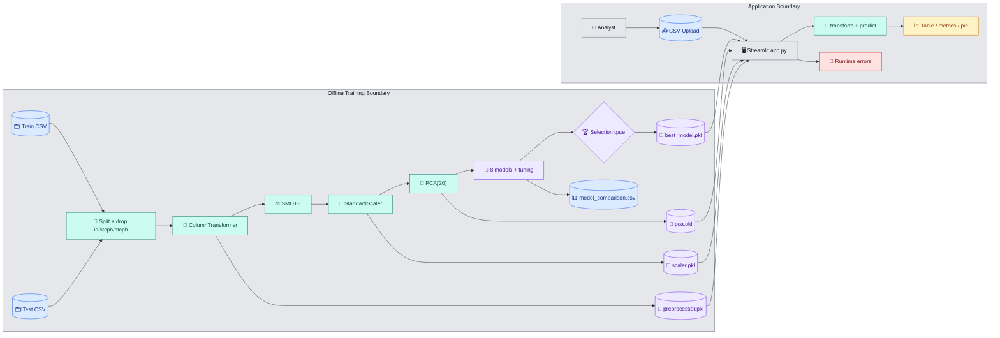
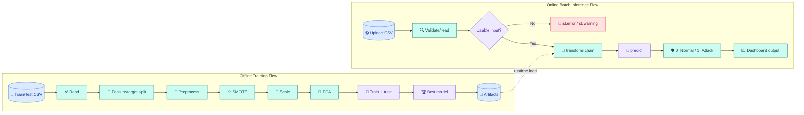
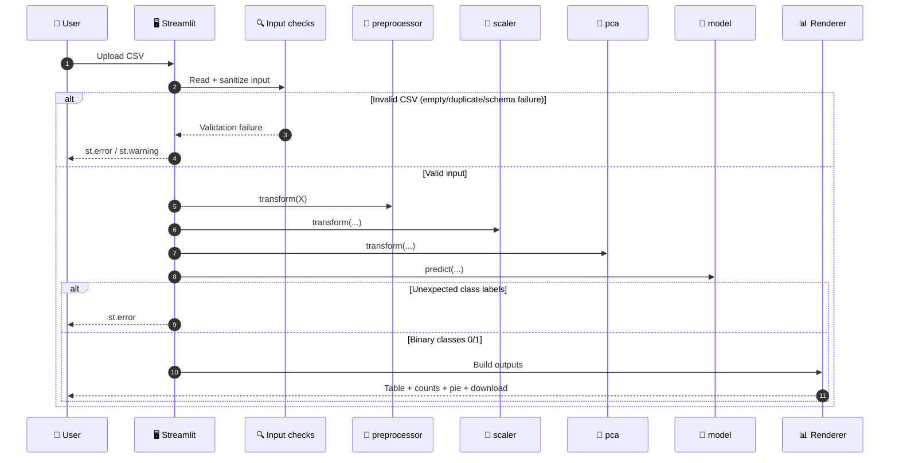
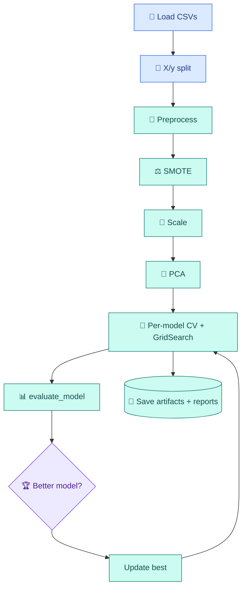
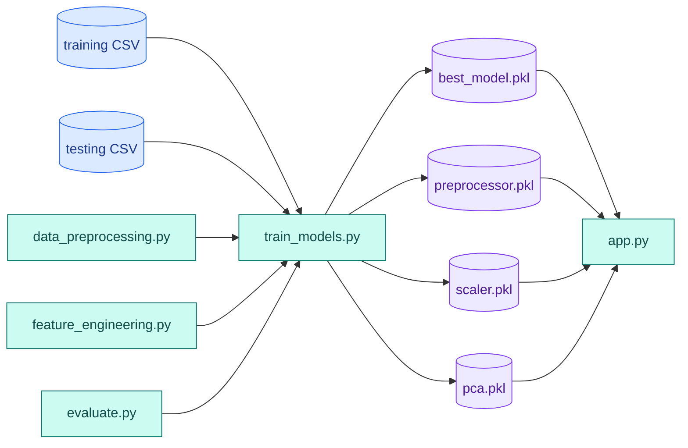

# Network Intrusion Detection using Machine Learning

> Binary network intrusion detection for UNSW-NB15-style tabular flow data, with a full training pipeline (`src/train_models.py`) and an interactive Streamlit inference dashboard (`src/app.py`).

## Table of Contents
- [1. Project Title and Introduction](#1-project-title-and-introduction)
- [2. Project Overview and Objectives](#2-project-overview-and-objectives)
- [3. Problem Statement and Motivation](#3-problem-statement-and-motivation)
- [4. Key Features and Capabilities](#4-key-features-and-capabilities)
- [5. Technology Stack](#5-technology-stack)
- [6. Dataset Description](#6-dataset-description)
- [7. Repository and Folder Structure](#7-repository-and-folder-structure)
- [8. System Architecture](#8-system-architecture)
- [9. End-to-End Data-Flow Architecture](#9-end-to-end-data-flow-architecture)
- [10. Detailed Implementation Workflow](#10-detailed-implementation-workflow)
- [11. Data Preprocessing and Feature Engineering](#11-data-preprocessing-and-feature-engineering)
- [12. Class Imbalance Handling and PCA](#12-class-imbalance-handling-and-pca)
- [13. Machine Learning Models and Model-Selection Strategy](#13-machine-learning-models-and-model-selection-strategy)
- [14. Training, Cross-Validation, and Hyperparameter Tuning](#14-training-cross-validation-and-hyperparameter-tuning)
- [15. Model Evaluation and Performance Metrics](#15-model-evaluation-and-performance-metrics)
- [16. Model Serialization and Artifact Management](#16-model-serialization-and-artifact-management)
- [17. Streamlit Application Architecture and Prediction Workflow](#17-streamlit-application-architecture-and-prediction-workflow)
- [18. Installation and Environment Setup](#18-installation-and-environment-setup)
- [19. Step-by-Step Execution Instructions](#19-step-by-step-execution-instructions)
- [20. Sample Input Format and Prediction Output](#20-sample-input-format-and-prediction-output)
- [21. Testing and Validation](#21-testing-and-validation)
- [22. Troubleshooting and Frequently Encountered Errors](#22-troubleshooting-and-frequently-encountered-errors)
- [23. Security, Limitations, and Responsible Use](#23-security-limitations-and-responsible-use)
- [24. Future Improvements](#24-future-improvements)
- [25. References and Contributors](#25-references-and-contributors)
- [Diagram Source Files](#diagram-source-files)

---

## 1. Project Title and Introduction

This project implements a **Machine Learning-based Network Intrusion Detection System (NIDS)** for binary classification:
- `0` → **Normal traffic**
- `1` → **Attack traffic**

The repository includes:
- an offline training/evaluation pipeline that compares multiple classifiers,
- serialized preprocessing/model artifacts,
- and a Streamlit dashboard for batch CSV inference and result visualization.

## 2. Project Overview and Objectives

### Overview
The system uses UNSW-NB15-derived CSV files to train and evaluate classical ML classifiers, then serves predictions through a local web UI.

### Objectives
- Train and compare multiple classification models on the same processed feature space.
- Prioritize balanced class behavior using macro F1, with additional emphasis on attack recall.
- Persist artifacts required for reproducible inference (`preprocessor`, `scaler`, `pca`, `best_model`).
- Provide an operator-friendly interface for CSV upload, prediction, and result inspection.

## 3. Problem Statement and Motivation

Network telemetry is high-volume and difficult to triage manually. In binary intrusion detection, false negatives (missed attacks) are costly, while false positives increase analyst load. This project demonstrates a practical ML workflow that emphasizes attack detection while exposing uncertainty and operational limitations.

## 4. Key Features and Capabilities

| Capability | Actual Implementation |
|---|---|
| Multi-model benchmarking | 8 candidate classifiers in `src/train_models.py` |
| Categorical preprocessing | `OneHotEncoder(handle_unknown="ignore")` inside `ColumnTransformer` |
| Class imbalance handling | `SMOTE(random_state=42)` on training features only |
| Dimensionality reduction | `PCA(n_components=20)` |
| Model selection gate | Macro F1 → Attack Recall → Accuracy |
| Evaluation metrics | Accuracy, weighted precision/recall/F1, macro F1, attack recall, ROC-AUC, confusion matrix, classification report |
| Artifact persistence | `joblib.dump` for 4 artifacts in `models/` |
| Interactive inference UI | Streamlit CSV upload, prediction table, class counts, pie chart, downloadable CSV |
| Optional label-based check | If uploaded CSV includes valid binary `label`, dashboard computes quick evaluation metrics |

## 5. Technology Stack

| Category | Tools |
|---|---|
| Language | 🐍 Python |
| Data Processing | 🐼 Pandas, 🔢 NumPy |
| ML & Imbalance Handling | 🤖 Scikit-learn, ⚖️ imbalanced-learn |
| Gradient Boosting | 🚀 XGBoost, 🌿 LightGBM |
| Visualization | 📊 Matplotlib, Seaborn |
| App Layer | 🖥️ Streamlit |
| Serialization | 💾 Joblib |

Dependencies are listed in [`requirements.txt`](requirements.txt).

## 6. Dataset Description

### Dataset files used by code
- `data/UNSW_NB15_training-set_updated.csv`
- `data/UNSW_NB15_testing-set_updated.csv`

### Observed schema from repository files
| Item | Value |
|---|---|
| Columns per file | 44 |
| Target column | `label` |
| Feature columns before dropping | 43 |
| Features used for modeling | 40 (after dropping `id`, `stcpb`, `dtcpb`) |
| Class task | Binary (`0` normal, `1` attack) |

### Categorical features encoded by preprocessing
- `proto`
- `service`
- `state`

All remaining feature columns are treated as numerical by `ColumnTransformer`.

### Data source note
The files are UNSW-NB15-derived tabular datasets. See references in [Section 25](#25-references-and-contributors).

## 7. Repository and Folder Structure

```text
network_intrusion_detection_upgrade/
├── README.md
├── requirements.txt
├── .gitignore
├── data/
│   ├── UNSW_NB15_training-set_updated.csv
│   ├── UNSW_NB15_testing-set_updated.csv
│   └── model_comparison.csv
├── docs/
│   └── diagrams/
│       ├── system-architecture.mmd
│       ├── end-to-end-data-flow.mmd
│       ├── training-pipeline.mmd
│       ├── inference-sequence.mmd
│       ├── module-dependencies.mmd
│       └── evaluation-feedback-loop.mmd
├── models/
│   ├── best_model.pkl
│   ├── preprocessor.pkl
│   ├── scaler.pkl
│   └── pca.pkl
├── outputs/
│   ├── before_smote.png
│   ├── after_smote.png
│   ├── correlation_heatmap.png
│   ├── feature_importance.png
│   └── model_comparison.png
└── src/
    ├── app.py
    ├── train_models.py
    ├── data_preprocessing.py
    ├── feature_engineering.py
    └── evaluate.py
```

### Important module responsibilities
| File | Responsibility |
|---|---|
| `src/train_models.py` | End-to-end offline training, tuning, model comparison, artifact export |
| `src/data_preprocessing.py` | Data loading, ColumnTransformer preprocessing, SMOTE, scaling |
| `src/feature_engineering.py` | Correlation heatmap, feature importance, PCA |
| `src/evaluate.py` | Metric computation and reporting helper |
| `src/app.py` | Streamlit UI, artifact loading, runtime transform+predict workflow |

## 8. System Architecture



Source: [`docs/diagrams/system-architecture.mmd`](docs/diagrams/system-architecture.mmd)

## 9. End-to-End Data-Flow Architecture



Source: [`docs/diagrams/end-to-end-data-flow.mmd`](docs/diagrams/end-to-end-data-flow.mmd)

## 10. Detailed Implementation Workflow

| Stage | Purpose | Input | Processing | Output | Source File |
|---|---|---|---|---|---|
| 1 | Load datasets | Train/test CSV paths | `pd.read_csv` via `load_data()` | `train_df`, `test_df` | `src/data_preprocessing.py` |
| 2 | Build train/test matrices | Loaded dataframes | Extract target `label`; drop `id`, `stcpb`, `dtcpb` from features | `X_train_raw`, `X_test_raw`, `y_train`, `y_test` | `src/train_models.py` |
| 3 | Preprocess | Raw train/test features | Fit `ColumnTransformer` on train only; transform train/test | Encoded matrices | `src/data_preprocessing.py` |
| 4 | Handle imbalance | Encoded train matrix + labels | Apply `SMOTE.fit_resample` to training set | Resampled `X_train`, `y_train` | `src/data_preprocessing.py` |
| 5 | Scale | Resampled train + encoded test | Fit `StandardScaler(with_mean=False)` on train; transform test | Scaled matrices | `src/data_preprocessing.py` |
| 6 | Engineer/analyze features | Training data | Correlation heatmap and RandomForest feature-importance chart | PNG files in `outputs/` | `src/feature_engineering.py`, `src/train_models.py` |
| 7 | Reduce dimensions | Scaled train/test | Fit PCA on train; transform test | PCA train/test matrices | `src/feature_engineering.py` |
| 8 | Train and tune models | PCA matrices + labels | `cross_val_score(cv=10)` and `GridSearchCV(cv=5)` | Tuned estimators and metrics | `src/train_models.py` |
| 9 | Evaluate | Predictions + scores | `evaluate_model` for metrics/report/CM | Per-model evaluation outputs | `src/evaluate.py` |
| 10 | Select best model | Model metrics | Gate: macro F1, then attack recall, then accuracy | Best estimator reference | `src/train_models.py` |
| 11 | Save artifacts | Best model + fitted transforms | `joblib.dump` objects | 4 `.pkl` files in `models/` | `src/train_models.py` |
| 12 | Serve inference | Uploaded CSV + saved artifacts | Transform-only chain + prediction + visualization | Output table, metrics, pie, CSV export | `src/app.py` |

## 11. Data Preprocessing and Feature Engineering

### Preprocessing (`src/data_preprocessing.py`)
- Detects categorical vs numeric columns by dtype.
- Uses `ColumnTransformer`:
  - numeric: passthrough
  - categorical: `OneHotEncoder(handle_unknown="ignore")`
- Fits transformation objects on training data before applying to test/inference inputs.

### Feature engineering and visualization (`src/feature_engineering.py`, `src/train_models.py`)
- Correlation heatmap uses numeric columns of training dataframe.
- Feature importance uses `RandomForestClassifier` and exports top-feature chart.
- PCA compresses feature space to 20 components after scaling.

## 12. Class Imbalance Handling and PCA

### Class imbalance handling
- `SMOTE(random_state=42)` is applied to transformed training data only.
- Class distribution plots are exported:
  - `outputs/before_smote.png`
  - `outputs/after_smote.png`

### PCA usage
- `PCA(n_components=20)` is fitted on scaled training data.
- Same fitted PCA object is reused at inference (`models/pca.pkl`).

## 13. Machine Learning Models and Model-Selection Strategy

### Implemented classifiers
`src/train_models.py` trains and tunes:
1. LightGBM (`LGBMClassifier`)
2. XGBoost (`XGBClassifier`)
3. KNN (`KNeighborsClassifier`)
4. Decision Tree (`DecisionTreeClassifier`)
5. Random Forest (`RandomForestClassifier`)
6. Logistic Regression (`LogisticRegression`)
7. Gaussian Naive Bayes (`GaussianNB`)
8. Calibrated Linear SVM (`CalibratedClassifierCV(LinearSVC)`)

### Best-model selection logic (actual code)
A model replaces the current best if:
1. macro F1 is higher, or
2. macro F1 ties and attack recall is higher, or
3. both tie and accuracy is higher.

Based on current `data/model_comparison.csv`, the selected best model is **XGBoost**.

## 14. Training, Cross-Validation, and Hyperparameter Tuning

### Verified training command
```bash
python src/train_models.py
```

### Training strategy implemented
- `cross_val_score(..., cv=10, n_jobs=-1)`
- `GridSearchCV(..., cv=5, n_jobs=-1)` per candidate model
- Final evaluation on the dedicated test CSV file

### Hyperparameter grids in code
| Model | Grid |
|---|---|
| LightGBM | `n_estimators=[100, 200]`, `learning_rate=[0.05, 0.1]` |
| XGBoost | `n_estimators=[100, 200]`, `learning_rate=[0.05, 0.1]` |
| KNN | `n_neighbors=[3, 5]` |
| DecisionTree | `max_depth=[10, 20]` |
| RandomForest | `n_estimators=[100, 200]`, `max_depth=[5, 10]` |
| LogisticRegression | `C=[0.1, 1]` |
| GaussianNB | `var_smoothing=[1e-12, 1e-10]` |
| Calibrated Linear SVM | `estimator__C=[0.01, 0.1, 1]` |

## 15. Model Evaluation and Performance Metrics

`src/evaluate.py` computes:
- Accuracy
- Precision (weighted)
- Recall (weighted)
- F1 (weighted)
- F1 (macro)
- Recall for attack class (`pos_label=1`)
- ROC-AUC (if probabilities/scores exist)
- Confusion matrix
- Classification report

### Current snapshot (`data/model_comparison.csv`)

| Model | CV Accuracy | Accuracy | F1 (macro) | Recall Attack | ROC-AUC |
|---|---:|---:|---:|---:|---:|
| XGBoost | 0.9415 | 0.8828 | 0.8799 | 0.9408 | 0.9734 |
| LightGBM | 0.9342 | 0.8827 | 0.8799 | 0.9409 | 0.9734 |
| KNN | 0.9376 | 0.8766 | 0.8736 | 0.9368 | 0.9261 |
| DecisionTree | 0.9349 | 0.8727 | 0.8697 | 0.9325 | 0.8851 |
| RandomForest | 0.9498 | 0.8706 | 0.8665 | 0.9501 | 0.9707 |
| Logistic | 0.8665 | 0.7819 | 0.7754 | 0.8645 | 0.9059 |
| NaiveBayes | 0.7552 | 0.6903 | 0.6855 | 0.5149 | 0.8495 |
| SVM_Linear | 0.8555 | 0.7655 | 0.7557 | 0.8766 | 0.8952 |

## 16. Model Serialization and Artifact Management

Training writes four required artifacts into `models/`:
- `best_model.pkl`
- `preprocessor.pkl`
- `scaler.pkl`
- `pca.pkl`

`src/app.py` loads all four artifacts, then performs transform-only inference:
1. `preprocessor.transform`
2. `scaler.transform`
3. `pca.transform`
4. `best_model.predict`

## 17. Streamlit Application Architecture and Prediction Workflow

### Verified app startup command
```bash
streamlit run src/app.py
```

### Inference sequence (valid + invalid paths)


Source: [`docs/diagrams/inference-sequence.mmd`](docs/diagrams/inference-sequence.mmd)

## 18. Installation and Environment Setup

### Windows PowerShell
```powershell
python -m venv .venv
.\.venv\Scripts\Activate.ps1
python -m pip install --upgrade pip
pip install -r requirements.txt
```

### Linux/macOS
```bash
python3 -m venv .venv
source .venv/bin/activate
python -m pip install --upgrade pip
pip install -r requirements.txt
```

## 19. Step-by-Step Execution Instructions

1. Create and activate a virtual environment.
2. Install dependencies from `requirements.txt`.
3. Train and export artifacts:
   ```bash
   python src/train_models.py
   ```
4. Launch dashboard:
   ```bash
   streamlit run src/app.py
   ```
5. Upload a compatible CSV file and inspect predictions.

## 20. Sample Input Format and Prediction Output

### Expected input behavior
- If present, `label` is dropped before prediction (used only for optional runtime evaluation).
- If present, `id`, `stcpb`, `dtcpb` are dropped before transform.
- Remaining columns should match the schema expected by the fitted preprocessor.

### Example header excerpt
```csv
dur,proto,service,state,spkts,dpkts,sbytes,dbytes,rate,sttl,dttl
0.121478,tcp,http,FIN,6,4,258,172,74.08749,252,254
```

### Prediction output columns
The dashboard appends:
- `Prediction Code` (`0` or `1`)
- `Prediction` (`Normal` or `Potential Attack`)

It also shows aggregate counts, percentages, pie chart, and allows CSV export.

## 21. Testing and Validation

This repository currently does **not** include an automated unit/integration test suite.

### Lightweight validation commands
```bash
# Syntax check
python -m py_compile src/*.py
```

Optional manual checks:
```bash
python src/train_models.py
streamlit run src/app.py
```

## 22. Troubleshooting and Frequently Encountered Errors

| Issue | Likely Cause | Resolution |
|---|---|---|
| `ModuleNotFoundError` | Missing dependencies | Activate environment and run `pip install -r requirements.txt` |
| Artifact load failure in app | Missing/corrupt `.pkl` files or version mismatch | Re-run training and ensure compatible Python/sklearn/xgboost versions |
| `Prediction failed...` in Streamlit | Uploaded CSV schema does not match fitted preprocessor expectations | Align columns with training feature schema |
| `No feature columns remain...` | Input only had dropped columns (`id`, `stcpb`, `dtcpb`, optional `label`) | Provide full feature set |
| Empty upload warning | CSV has no rows | Upload a non-empty dataset |

## 23. Security, Limitations, and Responsible Use

### Security and responsible use
- Treat uploaded network data as sensitive.
- Avoid exposing this app with untrusted public uploads without hardening.
- Use output as decision support, not as a standalone incident verdict.

### Current implementation limitations
- No CI-backed automated tests in repository.
- No explicit artifact metadata/version registry.
- Input validation is mostly runtime/exception-driven.
- Streamlit contains static historical model-score text that may drift from retrained results.
- CV/tuning currently run after global preprocessing+SMOTE+PCA on training data (not fully fold-local pipeline orchestration).

## 24. Future Improvements

The following are **proposed**, not currently implemented:
- End-to-end `imblearn.Pipeline` for fold-local preprocessing/SMOTE/PCA during CV.
- Strict schema validator for inference uploads.
- Artifact manifest with dependency versions and training metadata.
- Automated tests for preprocessing, training, and app inference flow.
- Drift monitoring, scheduled retraining, and analyst feedback integration.

## 25. References and Contributors

### References
- UNSW-NB15 dataset: <https://research.unsw.edu.au/projects/unsw-nb15-dataset>
- Scikit-learn: <https://scikit-learn.org/stable/>
- imbalanced-learn: <https://imbalanced-learn.org/stable/>
- Streamlit: <https://docs.streamlit.io/>

### Contributors
- Pratyay Bera (based on repository history)

---

## Diagram Source Files

- [docs/diagrams/system-architecture.mmd](docs/diagrams/system-architecture.mmd)
- [docs/diagrams/end-to-end-data-flow.mmd](docs/diagrams/end-to-end-data-flow.mmd)
- [docs/diagrams/training-pipeline.mmd](docs/diagrams/training-pipeline.mmd)
- [docs/diagrams/inference-sequence.mmd](docs/diagrams/inference-sequence.mmd)
- [docs/diagrams/module-dependencies.mmd](docs/diagrams/module-dependencies.mmd)
- [docs/diagrams/evaluation-feedback-loop.mmd](docs/diagrams/evaluation-feedback-loop.mmd)

### Diagram 3 — Model Training and Selection Pipeline



### Diagram 5 — Repository and Module Dependency Diagram



### Diagram 6 — Model Evaluation and Feedback Loop

```mermaid
flowchart LR
  classDef process fill:#CCFBF1,stroke:#0F766E,color:#134E4A;
  classDef model fill:#EDE9FE,stroke:#7C3AED,color:#4C1D95;
  classDef eval fill:#FEF3C7,stroke:#D97706,color:#92400E;
  classDef infra fill:#E5E7EB,stroke:#6B7280,color:#111827;

  cand["🧠 Candidate models"] --> score["📏 evaluate_model"]
  score --> metrics["Macro F1 / Attack Recall / Accuracy + others"]
  metrics --> select{"Selection gate"}
  select --> best["🏆 Best model"]
  select --> rest["Other models"]
  best --> persist["💾 Persist artifacts"]
  best --> comp["📊 model_comparison.csv"]
  rest --> comp
  comp --> analysis["🔎 Error/trade-off analysis"]
  analysis -. proposed .-> drift["📉 Drift monitoring"]
  drift -. proposed .-> retrain["♻️ Retraining"]

  class cand,best,rest model;
  class score,persist,analysis process;
  class metrics,select,comp eval;
  class drift,retrain infra;
```


