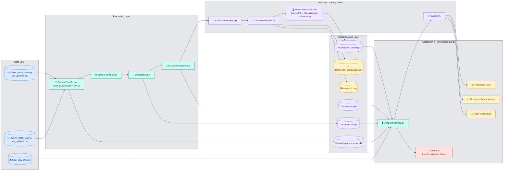
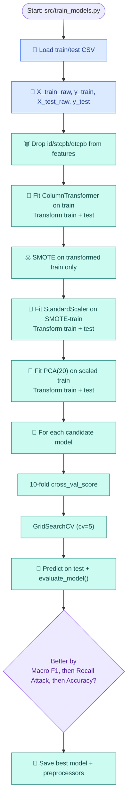
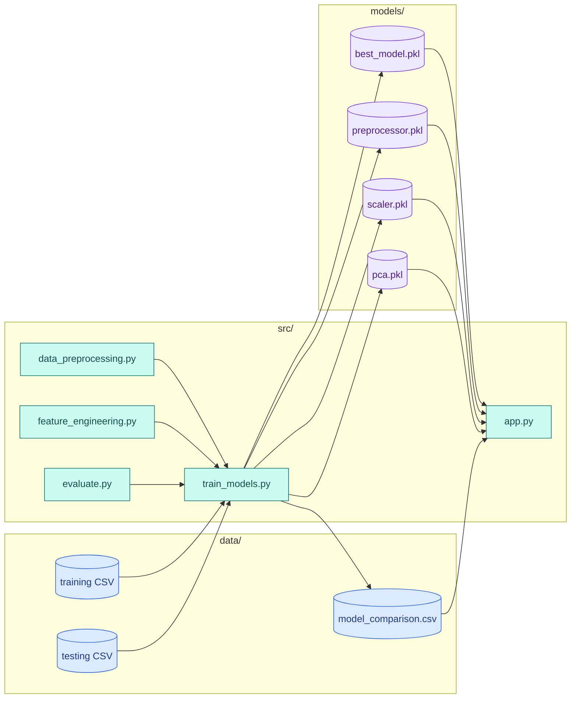
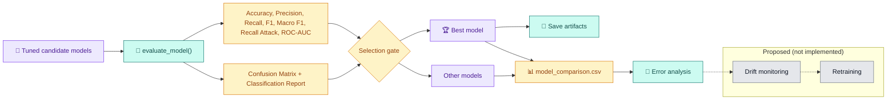

# Network Intrusion Detection using Machine Learning

> Binary network-traffic intrusion detection built with Python, Scikit-learn, Pandas/NumPy, and Streamlit using UNSW-NB15-derived CSV datasets in this repository.

## Table of Contents
- [1. Project Title and Introduction](#1-project-title-and-introduction)
- [2. Project Overview and Objectives](#2-project-overview-and-objectives)
- [3. Problem Statement and Motivation](#3-problem-statement-and-motivation)
- [4. Key Features and Capabilities](#4-key-features-and-capabilities)
- [5. Technology Stack](#5-technology-stack)
- [6. Dataset Description](#6-dataset-description)
- [7. Repository and Folder Structure](#7-repository-and-folder-structure)
- [8. System Architecture](#8-system-architecture)
- [9. End-to-End Data-Flow Architecture](#9-end-to-end-data-flow-architecture)
- [10. Detailed Implementation Workflow](#10-detailed-implementation-workflow)
- [11. Data Preprocessing and Feature Engineering](#11-data-preprocessing-and-feature-engineering)
- [12. Class Imbalance Handling and PCA](#12-class-imbalance-handling-and-pca)
- [13. Machine Learning Models and Selection Strategy](#13-machine-learning-models-and-selection-strategy)
- [14. Training, Cross-Validation, and Hyperparameter Tuning](#14-training-cross-validation-and-hyperparameter-tuning)
- [15. Model Evaluation and Performance Metrics](#15-model-evaluation-and-performance-metrics)
- [16. Model Serialization and Artifact Management](#16-model-serialization-and-artifact-management)
- [17. Streamlit Application Architecture and Prediction Workflow](#17-streamlit-application-architecture-and-prediction-workflow)
- [18. Installation and Environment Setup](#18-installation-and-environment-setup)
- [19. Step-by-Step Execution Instructions](#19-step-by-step-execution-instructions)
- [20. Sample Input Format and Prediction Output](#20-sample-input-format-and-prediction-output)
- [21. Testing and Validation](#21-testing-and-validation)
- [22. Troubleshooting](#22-troubleshooting)
- [23. Security, Limitations, and Responsible Use](#23-security-limitations-and-responsible-use)
- [24. Future Improvements](#24-future-improvements)
- [25. References and Contributors](#25-references-and-contributors)
- [Diagram Source Files](#diagram-source-files)

---

## 1. Project Title and Introduction

This repository implements a **Network Intrusion Detection System (NIDS)** that classifies traffic records as:
- `0` → Normal traffic
- `1` → Attack traffic

The training/evaluation pipeline is implemented in `src/train_models.py`, and an interactive prediction dashboard is implemented in `src/app.py`.

## 2. Project Overview and Objectives

### Objectives
- Train and compare multiple supervised classifiers for binary intrusion detection.
- Prioritize robust attack detection (class `1`) while preserving overall model quality.
- Persist preprocessing + model artifacts for reusable inference.
- Provide a Streamlit UI for CSV-based batch predictions and visual summaries.

## 3. Problem Statement and Motivation

Network telemetry is high-volume and high-dimensional. Manual triage is slow, and missed attacks are costly. This project automates binary attack detection from tabular network flow features and exposes results through an operator-friendly dashboard.

## 4. Key Features and Capabilities

| Capability | Implementation in Repository |
|---|---|
| Multi-model benchmarking | 8 candidate classifiers trained in `src/train_models.py` |
| Categorical handling | `OneHotEncoder(handle_unknown="ignore")` in `ColumnTransformer` |
| Class imbalance handling | `SMOTE(random_state=42)` on training data |
| Dimensionality reduction | `PCA(n_components=20)` |
| Metrics & reports | Accuracy, weighted precision/recall/F1, macro F1, attack recall, ROC-AUC, confusion matrix, classification report |
| Artifact persistence | `joblib` saves model + preprocessor + scaler + PCA |
| Interactive inference | Streamlit CSV upload, predictions table, counts, pie chart |

## 5. Technology Stack

| Area | Tools |
|---|---|
| Language | 🐍 Python |
| Data | 🐼 Pandas, 🔢 NumPy |
| ML | 🤖 Scikit-learn, ⚖️ imbalanced-learn (SMOTE), 🚀 XGBoost, 🌿 LightGBM |
| Visualization | 📊 Matplotlib, Seaborn |
| App/UI | 🖥️ Streamlit |
| Persistence | 💾 Joblib |

Dependencies are listed in `requirements.txt`.

## 6. Dataset Description

### Dataset files used by code
- `data/UNSW_NB15_training-set_updated.csv`
- `data/UNSW_NB15_testing-set_updated.csv`

### Observed schema from repository files
- Training rows: **175,341**
- Testing rows: **82,332**
- Columns: **44** per file
- Target column: **`label`**
- Label values: binary (`0`, `1`)

### Class counts in current files
| Split | Normal (`0`) | Attack (`1`) |
|---|---:|---:|
| Training | 56,000 | 119,341 |
| Testing | 37,000 | 45,332 |

### Feature overview
- Dropped before training/inference: `id`, `stcpb`, `dtcpb`
- Categorical columns detected in data and encoded: `proto`, `service`, `state`
- Remaining columns are treated as numeric by the pipeline.

> Source context: UNSW-NB15 family dataset (original dataset reference linked in [References](#25-references-and-contributors)).

## 7. Repository and Folder Structure

```text
network_intrusion_detection_upgrade/
├── README.md
├── requirements.txt
├── .gitignore
├── data/
│   ├── UNSW_NB15_training-set_updated.csv
│   ├── UNSW_NB15_testing-set_updated.csv
│   └── model_comparison.csv
├── models/
│   ├── best_model.pkl
│   ├── preprocessor.pkl
│   ├── scaler.pkl
│   └── pca.pkl
├── outputs/
│   ├── before_smote.png
│   ├── after_smote.png
│   ├── correlation_heatmap.png
│   ├── feature_importance.png
│   └── model_comparison.png
├── src/
│   ├── app.py
│   ├── train_models.py
│   ├── data_preprocessing.py
│   ├── feature_engineering.py
│   └── evaluate.py
└── docs/
    └── diagrams/
        ├── system-architecture.mmd
        ├── end-to-end-data-flow.mmd
        ├── training-pipeline.mmd
        ├── inference-sequence.mmd
        ├── module-dependencies.mmd
        └── evaluation-feedback-loop.mmd
```

## 8. System Architecture



## 9. End-to-End Data-Flow Architecture

```mermaid
flowchart LR
  classDef data fill:#dbeafe,stroke:#2563eb,color:#1e3a8a;
  classDef process fill:#ccfbf1,stroke:#0f766e,color:#134e4a;
  classDef model fill:#ede9fe,stroke:#7c3aed,color:#4c1d95;
  classDef eval fill:#fef3c7,stroke:#d97706,color:#92400e;
  classDef error fill:#fee2e2,stroke:#dc2626,color:#7f1d1d;

  subgraph OFF["Offline Training Workflow"]
    d1["📄 Train/Test CSV"] --> v1["✅ Load + Basic Schema Check"]
    v1 --> fs["🧩 Split Features & label"]
    fs --> drop["🗑️ Drop id, stcpb, dtcpb"]
    drop --> prep["🧹 OHE via ColumnTransformer"]
    prep --> bal["⚖️ SMOTE on train"]
    bal --> scl["📏 StandardScaler"]
    scl --> red["🧭 PCA (20)"]
    red --> train["🧠 Train + Tune 8 Models"]
    train --> sel["🏆 Select Best Model"]
    sel --> art[("💾 Persist model + preprocessors")]
    train --> rpt[("📊 model_comparison.csv + PNG reports")]
  end

  subgraph ON["Online / Batch Inference Workflow"]
    up["📤 CSV Upload"] --> iv["🔍 Input Read"]
    iv --> ivd{"Expected columns?"}
    ivd -->|No| e1["🚨 Prediction Error shown"]
    ivd -->|Yes| tr1["🧹 preprocessor.transform"]
    tr1 --> tr2["📏 scaler.transform()"]
    tr2 --> tr3["🧭 pca.transform()"]
    tr3 --> pred["🔮 best_model.predict()"]
    pred --> cls["🛡️ 0=Normal / 1=Attack"]
    cls --> viz["📈 Table + Metrics + Pie Chart"]
  end

  art -. loaded at runtime .-> tr1

  class d1,up,art data;
  class v1,fs,drop,prep,bal,scl,red,iv,tr1,tr2,tr3 process;
  class train,sel,pred model;
  class rpt,viz,cls eval;
  class e1 error;
```



## 10. Detailed Implementation Workflow

| Stage | Purpose | Input | Processing | Output | Source |
|---|---|---|---|---|---|
| 1. Load | Read train/test data | Two CSV paths | `pd.read_csv` in `load_data` | `train_df`, `test_df` | `src/data_preprocessing.py` |
| 2. Feature/target split | Build model inputs | Loaded dataframes | `drop(["label"] + dropped_cols)` and target extraction | `X_train_raw`, `y_train`, `X_test_raw`, `y_test` | `src/train_models.py` |
| 3. Preprocess | Encode categoricals safely | Raw X train/test | Fit `ColumnTransformer` on train, transform test | Encoded sparse matrices | `src/data_preprocessing.py` |
| 4. Balance classes | Handle imbalance in train set | Encoded train matrix + labels | `SMOTE.fit_resample` | Balanced train matrix/labels | `src/data_preprocessing.py` |
| 5. Scale | Normalize magnitudes | Train (resampled), test (encoded) | `StandardScaler(with_mean=False)` fit on train, transform test | Scaled matrices | `src/data_preprocessing.py` |
| 6. Feature analysis | Generate visual diagnostics | Training data | Heatmap + feature-importance plot generation | PNG charts in `outputs/` | `src/feature_engineering.py`, `src/train_models.py` |
| 7. PCA | Reduce dimensionality | Scaled train/test | Fit PCA on train, transform test | 20-component train/test matrices | `src/feature_engineering.py` |
| 8. Modeling | Train, tune, compare | PCA-transformed data | 10-fold CV + GridSearchCV(5) per model | Metrics rows and best estimator | `src/train_models.py` |
| 9. Evaluate | Quantify performance | `y_test`, predictions, scores | `evaluate_model` computes metrics + reports | Per-model metrics + confusion matrix/report | `src/evaluate.py` |
| 10. Persist | Enable reproducible inference | Best estimator + transforms | `joblib.dump` | `models/*.pkl` | `src/train_models.py` |
| 11. Inference UI | Operational usage | User-uploaded CSV | Transform-only pipeline + model prediction | Output table + traffic summary visualizations | `src/app.py` |

## 11. Data Preprocessing and Feature Engineering

### Preprocessing behavior
- Categorical columns are inferred via dtype `object`.
- Numerical columns are passed through unchanged.
- `ColumnTransformer` combines both into a single model matrix.
- `OneHotEncoder(handle_unknown="ignore")` avoids runtime failures for unseen categorical values.

### Feature engineering behavior
- Correlation heatmap is generated from numeric columns in the training dataframe.
- Feature importance chart is generated via a temporary `RandomForestClassifier`.
- PCA is applied after scaling with a fixed component count (`20`).

## 12. Class Imbalance Handling and PCA

### Class imbalance
- SMOTE is applied **only to training features/labels** after preprocessing.
- Before/after class distribution plots are exported:
  - `outputs/before_smote.png`
  - `outputs/after_smote.png`

### PCA
- `PCA(n_components=20)` is fit on scaled training data.
- The fitted PCA object is reused in inference from `models/pca.pkl`.

## 13. Machine Learning Models and Selection Strategy

Models currently implemented in `src/train_models.py`:
- LightGBM (`LGBMClassifier`)
- XGBoost (`XGBClassifier`)
- KNN
- Decision Tree
- Random Forest
- Logistic Regression
- Gaussian Naive Bayes
- Calibrated Linear SVM (`CalibratedClassifierCV(LinearSVC)`)

### Best-model selection rule in code
Model replacement occurs when:
1. Macro F1 is higher, or
2. Macro F1 ties and Attack Recall is higher, or
3. Both tie and Accuracy is higher.

Based on current `data/model_comparison.csv`, **XGBoost** is selected.

## 14. Training, Cross-Validation, and Hyperparameter Tuning

### Training command
```bash
python src/train_models.py
```

### Training strategy (as implemented)
- `cross_val_score(..., cv=10)` on training representation.
- `GridSearchCV(..., cv=5)` per model with small search grids.
- Tuned model evaluated on held-out test file.

### Hyperparameter grids
| Model | Grid |
|---|---|
| LightGBM | `n_estimators: [100, 200]`, `learning_rate: [0.05, 0.1]` |
| XGBoost | `n_estimators: [100, 200]`, `learning_rate: [0.05, 0.1]` |
| KNN | `n_neighbors: [3, 5]` |
| DecisionTree | `max_depth: [10, 20]` |
| RandomForest | `n_estimators: [100, 200]`, `max_depth: [5, 10]` |
| LogisticRegression | `C: [0.1, 1]` |
| GaussianNB | `var_smoothing: [1e-12, 1e-10]` |
| Calibrated LinearSVC | `estimator__C: [0.01, 0.1, 1]` |

## 15. Model Evaluation and Performance Metrics

Metrics generated in `src/evaluate.py`:
- Accuracy
- Precision (weighted)
- Recall (weighted)
- F1 (weighted)
- F1 (macro)
- Recall for attack class (`pos_label=1`)
- ROC-AUC (when score/probability available)
- Confusion matrix
- Classification report

### Current comparison snapshot (`data/model_comparison.csv`)

| Model | CV Accuracy | Accuracy | Macro F1 | Recall Attack | ROC-AUC |
|---|---:|---:|---:|---:|---:|
| XGBoost | 0.9415 | 0.8828 | 0.8799 | 0.9408 | 0.9734 |
| LightGBM | 0.9342 | 0.8827 | 0.8799 | 0.9409 | 0.9734 |
| KNN | 0.9376 | 0.8766 | 0.8736 | 0.9368 | 0.9261 |
| DecisionTree | 0.9349 | 0.8727 | 0.8697 | 0.9325 | 0.8851 |
| RandomForest | 0.9498 | 0.8706 | 0.8665 | 0.9501 | 0.9707 |
| Logistic | 0.8665 | 0.7819 | 0.7754 | 0.8645 | 0.9059 |
| NaiveBayes | 0.7552 | 0.6903 | 0.6855 | 0.5149 | 0.8495 |
| SVM_Linear | 0.8555 | 0.7655 | 0.7557 | 0.8766 | 0.8952 |

## 16. Model Serialization and Artifact Management

Artifacts created by training:
- `models/best_model.pkl`
- `models/preprocessor.pkl`
- `models/scaler.pkl`
- `models/pca.pkl`

Inference (`src/app.py`) loads all four artifacts and performs **transform-only** steps before prediction.

## 17. Streamlit Application Architecture and Prediction Workflow

Run the app from repository root:
```bash
streamlit run src/app.py
```

### Inference sequence
```mermaid
sequenceDiagram
  autonumber
  participant U as 👤 User
  participant S as 🖥️ Streamlit UI (src/app.py)
  participant V as 🔍 Input Reader/Validator
  participant P as 🧹 Preprocessor Artifact
  participant C as 📏 Scaler + 🧭 PCA Artifacts
  participant M as 🧠 best_model.pkl
  participant R as 📊 Result Views

  U->>S: Upload CSV file
  S->>V: pd.read_csv(uploaded_file)
  alt CSV parse or schema issue
    V-->>S: Exception / mismatched columns
    S-->>U: st.error("Prediction Error: ...")
  else CSV loaded
    V-->>S: DataFrame
    S->>V: Drop " label " if present; drop id/stcpb/dtcpb if present
    S->>P: preprocessor.transform(X)
    P-->>S: Encoded matrix
    S->>C: scaler.transform()
    C-->>S: Scaled matrix
    S->>C: pca.transform()
    C-->>S: PCA matrix
    S->>M: predict(X_pca)
    M-->>S: 0/1 predictions
    S->>R: Build results table + counts + pie chart
    R-->>U: Prediction dataframe and dashboard metrics
  end
```

## 18. Installation and Environment Setup

### Windows PowerShell
```powershell
python -m venv .venv
.\.venv\Scripts\Activate.ps1
python -m pip install --upgrade pip
pip install -r requirements.txt
```

### Linux/macOS
```bash
python3 -m venv .venv
source .venv/bin/activate
python -m pip install --upgrade pip
pip install -r requirements.txt
```

## 19. Step-by-Step Execution Instructions

1. **Install dependencies** using one of the setup blocks above.
2. **Train and export artifacts**:
   ```bash
   python src/train_models.py
   ```
3. **Launch Streamlit dashboard**:
   ```bash
   streamlit run src/app.py
   ```
4. **Upload a CSV file** with the same feature schema expected by the training pipeline.
5. **Review predictions** in table, metric cards, and pie chart.

## 20. Sample Input Format and Prediction Output

### Expected input columns
Inference expects the same feature schema as model training (excluding dropped fields):
- If present, `id`, `stcpb`, `dtcpb` are dropped before transform.
- If a label column exists with exact name **`" label "`** (with spaces), it is dropped; otherwise the app assumes all uploaded columns are features.

Example feature subset (CSV header excerpt):
```csv
dur,proto,service,state,spkts,dpkts,sbytes,dbytes,rate,sttl,dttl
0.121478,tcp,http,FIN,6,4,258,172,82.4,31,29
```

### Output
The app returns:
- Original uploaded rows
- Added `Prediction` column (`0` normal, `1` attack)
- Aggregate normal vs attack counts
- Pie chart distribution

## 21. Testing and Validation

This repository currently has **no automated test suite**.

Practical validation steps:
```bash
# Syntax check
python -m py_compile src/*.py

# Optional smoke-run (requires full dependencies/data)
python src/train_models.py
streamlit run src/app.py
```

## 22. Troubleshooting

| Issue | Likely Cause | Resolution |
|---|---|---|
| `ModuleNotFoundError` (e.g., pandas) | Dependencies not installed in active environment | Activate virtual env and run `pip install -r requirements.txt` |
| `FileNotFoundError` for data/models/outputs | Running from wrong working directory | Run commands from repository root |
| Streamlit `Prediction Error: ...` after upload | Column mismatch with trained preprocessor | Ensure input schema aligns with training features |
| App fails to load artifacts | `models/*.pkl` missing | Run `python src/train_models.py` first |

## 23. Security, Limitations, and Responsible Use

### Security and responsible use
- Treat uploaded network data as potentially sensitive.
- Validate source and handling of CSV inputs before operational use.
- Use this project for research/education/prototyping unless additional hardening is added.

### Current implementation limitations
- No automated CI tests in repository.
- No built-in model/version metadata registry.
- Input validation is mostly exception-driven during transform/predict.
- Static metric text exists in `src/app.py` and may diverge from regenerated `model_comparison.csv` if retrained.
- CV/tuning are performed after global preprocessing/SMOTE/PCA transformations on the training set, not via a single fold-local pipeline object.

## 24. Future Improvements

The following are **proposed enhancements** (not currently implemented):
- End-to-end `imblearn.Pipeline` to keep all train-only transforms fold-local during CV.
- Strict schema validation module for uploaded inference CSV files.
- Artifact metadata/version stamping and reproducibility manifest.
- Automated tests for preprocessing, training, and Streamlit inference flow.
- Drift monitoring, scheduled retraining, and analyst feedback integration.

## 25. References and Contributors

### References
- UNSW-NB15 dataset overview: https://research.unsw.edu.au/projects/unsw-nb15-dataset
- Scikit-learn docs: https://scikit-learn.org/stable/
- imbalanced-learn docs: https://imbalanced-learn.org/stable/
- Streamlit docs: https://docs.streamlit.io/

### Contributors
- Pratyay Bera (from repository commit history)

---

## Diagram Source Files

- [docs/diagrams/system-architecture.mmd](docs/diagrams/system-architecture.mmd)
- [docs/diagrams/end-to-end-data-flow.mmd](docs/diagrams/end-to-end-data-flow.mmd)
- [docs/diagrams/training-pipeline.mmd](docs/diagrams/training-pipeline.mmd)
- [docs/diagrams/inference-sequence.mmd](docs/diagrams/inference-sequence.mmd)
- [docs/diagrams/module-dependencies.mmd](docs/diagrams/module-dependencies.mmd)
- [docs/diagrams/evaluation-feedback-loop.mmd](docs/diagrams/evaluation-feedback-loop.mmd)

### Diagram 3: Model Training and Selection Pipeline


### Diagram 5: Repository and Module Dependency Diagram


### Diagram 6: Model Evaluation and Feedback Loop

